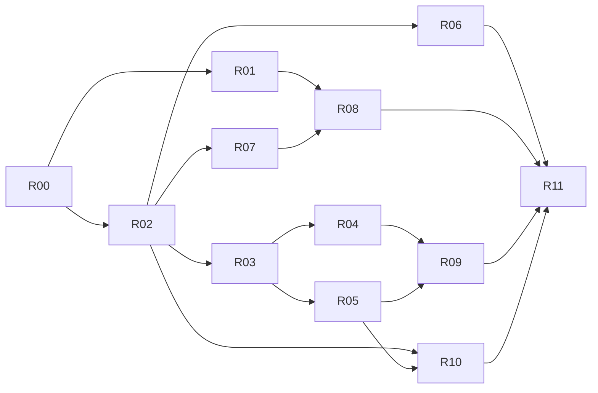

# StackChan 成人桌面伙伴 V1：AI 开发需求入口

- 文档状态：ACTIVE
- 需求状态：SPECIFIED（需求已经写明，不表示软件已经实现）
- 实现状态：R00 SOFTWARE_BASELINE_READY；R01 SOFTWARE_READY_FOR_REVIEW；R02–R11 NOT_STARTED；现场与部署待后续指令；2026-10-15 已授权推送任务分支
- 版本：1.0；2026-10-12；Asia/Shanghai
- 源码核对基准：`origin/master@989b3d9f591a854d9ca26fe05b78fb4af53329b5`
- 来源：[十二周产品迭代计划](../../project/companion-product-iteration-plan-2026-10-12.md)、[产品状态](../../project/status/product.md)。

2026-10-12：用户指定第一项R00，已完成软件兼容、隔离数据/恢复验证与生产候选。记录见[基线交接](../../project/baselines/companion-v1-baseline.md)；两项主观反馈已收集，第三真实样例/设备计时/安装待验。原需求包初始交付说明保留，不能解释为本轮未实施。

2026-10-14：用户进一步授权 R01 开发，要求 R00/R01 本地合并、暂不推送。软件回归、V61 升级/删除、双固件与生产候选完成，交付见[R01](../../project/baselines/companion-r01-natural-voice.md)；空匿名表不代表实体门槛通过。

2026-10-15：用户明确要求“推送吧”，只推 R00/R01 当前任务分支；PR、审核及合并由用户执行，现场与部署仍待授权。

## 1. 这套文件怎么使用

本目录包含十二份独立需求 R00–R11，以及本入口和一份公共契约。每个 R 文件对应一项可以单独分支、开发、验证、交接的需求。单份需求内部仍会涉及服务端、网页、固件，不能按端各自推断不同的行为。开发 AI 每次只实施选定的一份；读取公共契约与依赖的必要接口，不顺手开发下一份。

需求包落实原计划的行为细节。计划书中的产品方向、十二周相对排期保留；本包确定各项默认值、状态、异常、接口增量和验收。软件代码与新鲜验证优先于历史状态：执行前若发生主线变化，应记录差异，保留已经实现的能力，再调整实施路径；不能以旧需求覆盖已合入的新功能。

文档中“现有”指核对基准已存在的代码；“新增/拟新增”指本包要求实施的增量。接口与表结构建议属于新增设计，不代表仓库已经存在这些接口。所有列为 MVP 的 FR 和 AC 都要通过；标为后续可选的能力不属于完成门槛。SPECIFIED 不代表用户已经授权刷写、部署、真实外发或 Git 推送。

## 2. 用户和最终体验

首期用户是拥有本设备的单一成人管理员，主伙伴固定，其他角色/设备继续隔离。产品要做到：能自然交代一件真实事情，获得有依据的成果，纠正理解后继续推进，跨天无需反复解释背景；用声音和现有眼神表现实际状态；用户忙碌、停止或关闭主动时保持安静。

首个可复现项目为“比较用户提供的二至三个公开 HTTPS 桌面布置方案，给出符合尺寸/预算/偏好的建议”。这是默认验收夹具，用户可以换成现有工具能完成的真实目标。无需购买商品，不凭空补齐价格或资料，不把所有委托改成必须填写 RSS。

## 3. 文件清单和做到什么程度

| 编号 / 原计划 | 独立文档 | 必须交付的结果 | 软件开始条件 |
| --- | --- | --- | --- |
| R00 / PLAN-00 | [基线与兼容整合](R00-baseline-and-integration.md) | 三种版本事实、保留 V57 的验证候选、迁移/回退证据和真实失败基线；没有自动安装 | 可以先做只读核对；源码整合遵循任务授权 |
| R01 / TALK-01 | [自然语音](R01-natural-voice.md) | 可测首声、短答、续讲、限时录音提示、触摸停止与下一回合恢复；不是强制全双工 | R00 的语音基线和来源明确 |
| R02 / LOOP-01 | [一项真实项目的最小闭环](R02-project-loop.md) | 自然交代→现有委托→有依据成果→待阅→纠正→下一行动→暂停；最小成果卡 | R00 兼容候选；现有工具可用 |
| R03 / GOAL-01 | [目标生命周期与反馈](R03-goal-lifecycle.md) | 有限阶段、完成标准、修订、受阻、明确采用与完成；不是提醒任务改名 | R02 已有可用成果 |
| R04 / GOAL-01 | [持久执行与恢复](R04-durable-execution.md) | 复用调度/租约/运行历史，修订防晚到、重启恢复、未知写副作用不双发 | R03 数据契约；R05 最小权限守卫同步交付 |
| R05 / GOAL-01 | [权限、批准与预算](R05-permissions-and-budgets.md) | 服务器绑定范围、逐动作批准、有限执行、暂停撤销及成本未知说明 | R03；与 R04 在首个 goal-owned 执行启用前共同验收 |
| R06 / MEMORY-01 | [记忆与跨天接续](R06-memory-continuity.md) | 复用确认记忆/V57，当前事实优先、纠正替代、删除不复现和相关目标召回 | R00 保留 V57；R02 项目上下文；目标增强部分等 R03 |
| R07 / PRESENCE-01 | [主动时机与注意预算](R07-proactive-attention.md) | 默认关闭的统一普通主动策略、专注/免打扰/拒绝退让、过期不补播 | R02 待阅事件；R01 音频占用状态 |
| R08 / PRESENCE-01 | [具身表达和状态可读性](R08-embodied-expression.md) | 现有眼神/界面映射听、处理、说、受阻和待阅，安静优先且资源不过线 | R00 资源基线；R01/R02 状态；主动显示遵循 R07 |
| R09 / HANDOFF-01 | [手机网页与设备接续](R09-mobile-handoff.md) | 手机登录看完整成果/来源/反馈，设备读取同一进度；Bark 只作通知 | R02；完整目标操作依赖 R03–R05 |
| R10 / GOAL-01 | [真实能力与来源证据](R10-capability-and-evidence.md) | 实时可用目录、可信来源、缺能力可解释，禁止伪造执行与来源 | R02 即须使用现有证据；新增目标约束依赖 R03/R05 |
| R11 / PILOT-01 | [十四天观察与发布门槛](R11-pilot-and-release.md) | 匿名真实指标、证据不足与失败区分、候选/备份/回退清单；没有自动部署 | 可提前写采集；正式观察需候选稳定且用户明确开始 |

## 4. 推荐开发顺序与并行边界

1. 先 R00。它的只读核对不需要设备写操作；兼容整合完成之前，不拿缺 V57 的主线替换历史安装。
2. 第一条路径做 R01 与 R02；只实现 R08 的最小既有状态映射，并直接沿用现有权限、停止、证据与静音规则。R02 不被完整 R03–R05 阻塞。
3. R03 先冻结数据与状态契约；R04、R05 可以分支并行，但 goal-owned 自动运行只有两者共同通过后才能启用。R10 的现有证据检查自 R02 起生效，增强目录跟随这一组。
4. 做 R06、R07 与 R08 完整验收；它们可以并行，但同一设备的声音仲裁、角色绑定与进度源只保留一个事实来源。
5. 做 R09 完整接续；R11 的匿名记录能力可以提前准备，十四天观察必须等待稳定候选和用户开始。



图中箭头是完整验收依赖，不要求等待全部上游才写测试或做只读设计。R04 与 R05 共同启用是一个功能门禁，不应实现成互相等待的环。十二周来自计划建议，不要求 AI 跳过失败检查以赶日期。

R03需要的最小artifact引用按R10冻结的数据契约在R03落实，R05需要的最小内置效果类别同样先落实；不等待R10完整目录界面或所有证据增强。R10随后复用这一单一基础补齐其余FR，不能另建成果/权限服务。这些是当前需求必要接口，不是偷偷实施整个后续任务。

## 5. 统一必读和责任归属

每项先读 [公共契约](00-shared-contracts.md)，再读目标需求的现况、依赖和验收。仓库规则见 [AGENTS.md](../../../AGENTS.md)、[根说明](../../../README.md)、[项目说明](../../project/README.md)、[状态总览](../../project/status/overview.md)和所属工作流状态。命令环境见[开发环境](../../project/development.md)。

| 跨文档概念 | 唯一规则归属 | 其他文档必须遵循 |
| --- | --- | --- |
| 版本/历史安装/资源 | R00 | 所有“现有”表述先核对版本 |
| 语音停止/时延 | R01 | R07/R08 不占用或复活已取消回合 |
| 目标/阶段/反馈语义 | R03 | R04/R06/R09 不自定义完成枚举 |
| 租约、幂等、重启和未知结果 | R04 | R05/R09 不重试未知写入 |
| 动作权限与执行预算 | R05 | 所有渠道使用服务器同一守卫 |
| 事实替代/接续许可 | R06 | 外部成果不会自动成为用户记忆 |
| 普通主动时机/预算 | R07 | R08 仅显示获准候选，不另开来源 |
| 现有协议/身体资源 | R08 | 新字段可选且兼容旧固件 |
| 认证、手机状态和已读 | R09 | SENT 不表示已读或用户采用 |
| 工具目录与证据真伪 | R10 | 任何成果不能用模型声明替代真实调用 |
| 观察与发布决策 | R11 | 工程通过不替代真实价值记录 |

冲突处理：公共契约负责共同字段与硬边界，归属文档负责细节。发现不可兼容差异，先保持更严格权限与旧数据，明确修改两个冲突文档并重跑受影响验收；不在实现里偷偷选更宽松解释。

## 6. 可直接交给 AI 的执行指令

将以下指令与所选 R 文件、公共契约一起交给有仓库访问权限的 AI。它必须实际读取依赖，不能仅按贴出的代码样例假定接口已存在。

```text
请在 StackChan 仓库实施 docs/requirements/companion-v1/ 下我指定的一项需求。
先读该目录 README.md、00-shared-contracts.md、选定需求全文，以及仓库 AGENTS.md 要求的状态和关联设计。
按最新 master 建独立 codex/ 任务分支；保留用户与其他任务的未提交文件。
先核对需求中的现有能力和当前代码；记录已实现/需增量/不在范围，不重建调度、记忆或通知系统。
按 FR 编号实施全部 MVP 行为，处理异常、权限、取消、并发、旧版本兼容和数据迁移。
按 AC 编号验证，用真实状态证明成果；人工/设备/14天观察尚未完成的项目标记待验收，不能伪造通过。
只做本需求及它明确要求的最小依赖接口；不要顺手实现下一份，不擅自安装、刷写、部署、真实外发、推送或创建 PR。
执行需求列出的相关测试、git diff --check、pnpm docs:check；更新对应工作流与全局总览，交接精确下一步。
交付中文变更说明，逐条列出 FR/AC 完成、证据、未完成与阻塞；任务相对 master 保留一个中文提交。
若已授权的软件任务可以继续，完成所有可执行工作；遇真实外部授权门禁时先把候选、验证与回退准备完整再停下。
```

把“我指定的一项需求”换为例如 `R01-natural-voice.md`。仅将单文件发给 AI 时，至少附公共契约和入口；若 AI 没有仓库访问，必须先让它列出缺少的事实材料，不许编造现状和测试结果。

## 7. 每项开发交付格式

每项需提供：改动路径及目的；数据库/协议/接口变化；FR→实现→AC→证据对照；执行命令、版本、通过/失败/跳过数量；实际设备与人工验证范围；配置默认值；兼容与回退；未完成和下一条精确操作。没有必要另建十二个空壳服务或十二套前端状态。

完成分两层：代码实现通过相关自动验收，可进入 READY_FOR_REVIEW；实体测量、人工采用、十四天使用及部署门槛各自记录。未完成外部验证不应写为“全量上线完成”。不能借缺少人工体验记录，把已经授权且可完成的软件工作留作 TODO。

## 8. 本期共同不做的事

不建设通用云电脑、任意生成执行工具、独立移动 App、多用户订阅、支付购买、广泛私人应用写入、常开云录音、摄像头推断情绪、复杂舞蹈或关系等级。不采购付费连接器。若真实目标被现有能力阻塞，说明缺什么并给手动提供资料/纯文本草稿路径；新增服务商需要单独需求和预算。

## 9. 本次需求交付的验收

十二项文件全部有代码起点、范围、明确行为、异常、接口/数据增量、体验文字、验收和 AI 交接；共用状态和限额保持一致；相对链接存在；与历史安装差异明确。此次不运行模型、Bark、观察窗口或硬件，不宣称软件性能通过。本包验证结果记录于[产品状态](../../project/status/product.md)。
